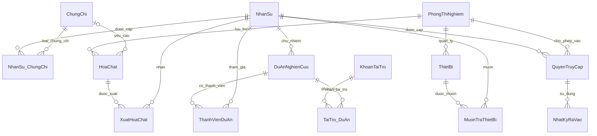

# Kế hoạch và thiết kế cơ sở dữ liệu giữa kỳ

## 1. Thông tin và mục tiêu

- **Môn học:** Cơ sở dữ liệu.
- **Đề tài 4:** Hệ thống theo dõi tài sản nghiên cứu và phòng thí nghiệm đại học.
- **Nhóm:** 3 sinh viên.
- **Quy mô:** 14 bảng dữ liệu.
- **Mục tiêu:** Phân tích nghiệp vụ, thiết kế ER/EER, ánh xạ quan hệ, xác định PK/FK, chuẩn hóa, xây dựng dữ liệu mẫu, truy vấn và trigger.
- **Hệ quản trị đề xuất:** SQL Server; đối chiếu yêu cầu giảng viên trước khi viết SQL.

Đây là thiết kế đề xuất phù hợp phạm vi bài giữa kỳ. Nhóm cần đối chiếu đề bài và mẫu báo cáo chính thức, nhất là yêu cầu EER, hệ quản trị và số lượng truy vấn/trigger.

## 2. Phạm vi và giả định

### Chức năng

1. Quản lý nhân sự, phòng thí nghiệm, chứng chỉ và quyền ra/vào.
2. Quản lý thiết bị và lịch sử mượn/trả.
3. Quản lý hóa chất, tồn kho và lịch sử xuất dùng.
4. Quản lý dự án nghiên cứu, thành viên và nguồn tài trợ.

### Giả định để giữ phạm vi vừa sức

- Mỗi nhân sự có đúng một vai trò chính: sinh viên, giảng viên hoặc kỹ thuật viên.
- Mỗi thiết bị vật lý có mã riêng, thuộc một phòng; không theo dõi lịch sử chuyển phòng.
- Mỗi dòng hóa chất quản lý một loại hóa chất tại một phòng. Cùng hóa chất ở hai phòng có hai mã quản lý khác nhau; chưa quản lý lô, hạn dùng hoặc nhiều kho trong một phòng.
- Mỗi hóa chất có tối đa một loại chứng chỉ bắt buộc. Hóa chất nguy hiểm phải có chứng chỉ bắt buộc; người nhận phải có chứng chỉ hợp lệ.
- Nhập kho bằng cập nhật tồn đầu kỳ/bổ sung có kiểm soát; chưa lưu lịch sử nhập kho.
- Mỗi lượt mượn gắn một thiết bị, mỗi lượt xuất gắn một hóa chất; không thiết kế phiếu nhiều dòng.
- Nhật ký lưu một lượt vào và thời điểm ra tương ứng; không tích hợp máy quẹt thẻ.
- Một khoản tài trợ phân bổ được cho nhiều dự án; một dự án nhận được nhiều khoản tài trợ.
- Không triển khai kế toán, mua sắm, bảo trì chi tiết, đặt trước thiết bị hoặc tài khoản đăng nhập ứng dụng.

## 3. Quy ước

- **PK:** Khóa chính, xác định duy nhất một bản ghi.
- **FK:** Khóa ngoại, tham chiếu khóa chính của bảng khác.
- **UQ:** Giá trị hoặc tổ hợp giá trị không trùng.
- Chỉ các thuộc tính ghi rõ **NULL** được để trống; các thuộc tính khác bắt buộc có giá trị.
- Mã đơn dùng `INT IDENTITY`; bảng liên kết có thể dùng khóa ghép.
- Tiền dùng `DECIMAL(18,2)`, thống nhất VND; lượng hóa chất dùng `DECIMAL(18,3)`; thời điểm dùng `DATETIME2`; văn bản tiếng Việt dùng `NVARCHAR`.
- Không xóa dây chuyền dữ liệu nghiệp vụ. FK ngăn xóa bản ghi đang được tham chiếu; nhân sự/tài sản ngừng sử dụng được đánh dấu trạng thái.

## 4. Danh sách 14 bảng

| STT | Bảng | Ý nghĩa | PK | FK |
|---|---|---|---|---|
| 1 | `PhongThiNghiem` | Danh mục phòng | `MaPhong` | Không |
| 2 | `NhanSu` | Sinh viên, giảng viên, kỹ thuật viên | `MaNhanSu` | Không |
| 3 | `ChungChi` | Danh mục loại chứng chỉ | `MaChungChi` | Không |
| 4 | `NhanSu_ChungChi` | Lịch sử cấp/gia hạn chứng chỉ | (`MaNhanSu`, `MaChungChi`, `NgayCap`) | `MaNhanSu`, `MaChungChi` |
| 5 | `QuyenTruyCap` | Quyền vào phòng có thời hạn | `MaQuyen` | `MaNhanSu`, `MaPhong` |
| 6 | `NhatKyRaVao` | Lượt ra/vào theo quyền | `MaNhatKy` | `MaQuyen` |
| 7 | `KhoanTaiTro` | Nguồn tài trợ và kinh phí | `MaTaiTro` | Không |
| 8 | `DuAnNghienCuu` | Dự án và chủ nhiệm | `MaDuAn` | `MaChuNhiem` |
| 9 | `TaiTro_DuAn` | Phân bổ tài trợ cho dự án | (`MaTaiTro`, `MaDuAn`) | `MaTaiTro`, `MaDuAn` |
| 10 | `ThanhVienDuAn` | Thành viên ngoài chủ nhiệm | (`MaDuAn`, `MaNhanSu`) | `MaDuAn`, `MaNhanSu` |
| 11 | `ThietBi` | Từng thiết bị vật lý | `MaThietBi` | `MaPhong` |
| 12 | `MuonTraThietBi` | Lịch sử mượn/trả | `MaLuotMuon` | `MaThietBi`, `MaNhanSu` |
| 13 | `HoaChat` | Hóa chất và tồn kho | `MaHoaChat` | `MaPhong`, `MaChungChiBatBuoc` |
| 14 | `XuatHoaChat` | Lịch sử xuất dùng | `MaLuotXuat` | `MaHoaChat`, `MaNhanSu` |

### 4.1. PhongThiNghiem

- Thuộc tính: `MaPhong` (PK), `TenPhong` (UQ), `ViTri`, `MoTa` (NULL).
- Giả định tên phòng duy nhất trong hệ thống.

### 4.2. NhanSu

- Thuộc tính: `MaNhanSu` (PK), `MaDinhDanh` (UQ), `HoTen`, `Email` (UQ), `LoaiNhanSu`, `DonVi`, `DangHoatDong`.
- `MaDinhDanh` là mã quản lý thống nhất, ví dụ SV001, GV001, KTV001.
- `LoaiNhanSu` chỉ nhận SinhVien, GiangVien, KyThuatVien; `DangHoatDong` dùng BIT.
- `DonVi` là tên khoa/bộ môn dạng văn bản; chưa quản lý danh mục đơn vị riêng.

### 4.3. ChungChi

- Thuộc tính: `MaChungChi` (PK), `TenChungChi` (UQ), `MoTa` (NULL).
- Ví dụ: An toàn hóa chất, An toàn sinh học.
- Thời hạn đặt ở từng lần cấp trong bảng `NhanSu_ChungChi`.

### 4.4. NhanSu_ChungChi

- Thuộc tính: `MaNhanSu` (PK, FK → NhanSu.MaNhanSu), `MaChungChi` (PK, FK → ChungChi.MaChungChi), `NgayCap` (PK), `NgayHetHan`, `BiThuHoi`.
- PK ghép: (`MaNhanSu`, `MaChungChi`, `NgayCap`).
- Hai cột ngày dùng DATE; giả định một người chỉ được cấp một lần cho cùng loại chứng chỉ trong một ngày.
- Cho phép lưu nhiều lần cấp/gia hạn. `NgayHetHan >= NgayCap`; `BiThuHoi` dùng BIT.
- Hợp lệ tại ngày sử dụng khi `NgayCap <= ngày sử dụng <= NgayHetHan` và chưa bị thu hồi.

### 4.5. QuyenTruyCap

- Thuộc tính: `MaQuyen` (PK), `MaNhanSu` (FK → NhanSu.MaNhanSu), `MaPhong` (FK → PhongThiNghiem.MaPhong), `TuNgay`, `DenNgay`, `BiThuHoi`.
- Hai cột thời hạn dùng DATETIME2; `BiThuHoi` dùng BIT; `DenNgay > TuNgay`.
- Một người có thể được cấp quyền vào cùng phòng nhiều lần, mỗi lần có mã riêng.

### 4.6. NhatKyRaVao

- Thuộc tính: `MaNhatKy` (PK), `MaQuyen` (FK → QuyenTruyCap.MaQuyen), `ThoiGianVao`, `ThoiGianRa` (NULL).
- Không lưu lặp `MaNhanSu`, `MaPhong` vì xác định được qua `MaQuyen`.
- Thời gian ra là NULL khi chưa ra; nếu có phải >= thời gian vào.
- Khi vào: nhân sự đang hoạt động, quyền chưa thu hồi, `TuNgay <= ThoiGianVao < DenNgay`.
- Cho phép ghi thời gian ra sau khi quyền hết hạn để hoàn tất lượt vào hợp lệ trước đó.

### 4.7. KhoanTaiTro

- Thuộc tính: `MaTaiTro` (PK), `TenKhoanTaiTro`, `DonViTaiTro`, `TongKinhPhi`, `NgayBatDau`, `NgayKetThuc`.
- `TongKinhPhi > 0`; `NgayKetThuc >= NgayBatDau`.

### 4.8. DuAnNghienCuu

- Thuộc tính: `MaDuAn` (PK), `TenDuAn`, `MaChuNhiem` (FK → NhanSu.MaNhanSu), `NgayBatDau`, `NgayKetThuc` (NULL), `TrangThai`.
- Nếu có ngày kết thúc thì phải >= ngày bắt đầu.
- Trạng thái: ChuaBatDau, DangThucHien, HoanThanh, TamDung.
- Mỗi dự án có đúng một chủ nhiệm và chủ nhiệm phải là giảng viên. FK chỉ kiểm tra người tồn tại; điều kiện giảng viên cần kiểm tra riêng.

### 4.9. TaiTro_DuAn

- Thuộc tính: `MaTaiTro` (PK, FK → KhoanTaiTro.MaTaiTro), `MaDuAn` (PK, FK → DuAnNghienCuu.MaDuAn), `SoTienPhanBo`.
- PK ghép: (`MaTaiTro`, `MaDuAn`); `SoTienPhanBo > 0`.
- Mỗi cặp lưu tổng phân bổ; chưa theo dõi từng đợt giải ngân.
- Tổng phân bổ của một khoản tài trợ không vượt `TongKinhPhi`. Đây là ràng buộc liên bảng.

### 4.10. ThanhVienDuAn

- Thuộc tính: `MaDuAn` (PK, FK → DuAnNghienCuu.MaDuAn), `MaNhanSu` (PK, FK → NhanSu.MaNhanSu), `NgayThamGia`, `VaiTro`.
- PK ghép: (`MaDuAn`, `MaNhanSu`); vai trò: NghienCuuVien, TroLy, KyThuat.
- Chỉ lưu thành viên ngoài chủ nhiệm. Chủ nhiệm xác định tại `DuAnNghienCuu.MaChuNhiem`, không ghi lặp tại bảng này.
- Danh sách đầy đủ người tham gia là hợp của chủ nhiệm và thành viên.

### 4.11. ThietBi

- Thuộc tính: `MaThietBi` (PK), `TenThietBi`, `MaPhong` (FK → PhongThiNghiem.MaPhong), `NgayDuaVaoSuDung`, `TinhTrang`.
- Tình trạng: SuDungDuoc, BaoTri, NgungSuDung.
- “Đang được mượn” suy ra từ lượt mượn chưa trả, không lưu lặp thành tình trạng thiết bị.

### 4.12. MuonTraThietBi

- Thuộc tính: `MaLuotMuon` (PK), `MaThietBi` (FK → ThietBi.MaThietBi), `MaNhanSu` (FK → NhanSu.MaNhanSu), `ThoiGianMuon`, `HanTra`, `ThoiGianTra` (NULL).
- `HanTra > ThoiGianMuon`; nếu có thời gian trả thì phải >= thời gian mượn.
- Chỉ tạo lượt mượn khi thiết bị SuDungDuoc và người mượn đang hoạt động.
- Mỗi thiết bị có tối đa một lượt mượn chưa trả: SQL Server có thể dùng unique filtered index trên `MaThietBi` với điều kiện `ThoiGianTra IS NULL`.
- Chỉ ghi mượn/trả thực tế; không đặt trước hoặc nhập lịch sử chồng lấn.

### 4.13. HoaChat

- Thuộc tính: `MaHoaChat` (PK), `TenHoaChat`, `MaPhong` (FK → PhongThiNghiem.MaPhong), `DonViTinh`, `SoLuongTon`, `NguongToiThieu`, `LaNguyHiem`, `DieuKienBaoQuan`, `MaChungChiBatBuoc` (FK → ChungChi.MaChungChi, NULL).
- UQ (`MaPhong`, `TenHoaChat`): một loại hóa chất chỉ có một dòng trong một phòng.
- Đơn vị: g, ml, mol; mỗi dòng dùng một đơn vị cố định, không tự quy đổi.
- `LaNguyHiem` dùng BIT; nếu bằng 1 thì chứng chỉ bắt buộc không được NULL.
- `SoLuongTon >= 0`, `NguongToiThieu >= 0`; tồn kho phải cập nhật cùng giao dịch xuất.

### 4.14. XuatHoaChat

- Thuộc tính: `MaLuotXuat` (PK), `MaHoaChat` (FK → HoaChat.MaHoaChat), `MaNhanSu` (FK → NhanSu.MaNhanSu), `ThoiGianXuat`, `SoLuongXuat`, `MucDich`.
- `SoLuongXuat > 0`; đơn vị lấy từ hóa chất; người nhận phải đang hoạt động.
- Chỉ xuất khi đủ tồn và có chứng chỉ hợp lệ nếu hóa chất yêu cầu.
- Lượt xuất đã ghi nhận không sửa/xóa trực tiếp trong phạm vi bài. Nếu mở rộng sửa/xóa, phải bổ sung xử lý hoàn tồn và kiểm tra lại nghiệp vụ.

## 5. Mối quan hệ giữa các bảng

Trong bảng sau, một bản ghi cha có thể có 0 đến nhiều bản ghi con; mỗi bản ghi con tham chiếu đúng một cha, trừ FK chứng chỉ của hóa chất cho phép NULL.

| Bảng cha (phía 1) | Bảng con (phía N) | FK ở bảng con |
|---|---|---|
| NhanSu | NhanSu_ChungChi | MaNhanSu |
| ChungChi | NhanSu_ChungChi | MaChungChi |
| NhanSu | QuyenTruyCap | MaNhanSu |
| PhongThiNghiem | QuyenTruyCap | MaPhong |
| QuyenTruyCap | NhatKyRaVao | MaQuyen |
| NhanSu | DuAnNghienCuu | MaChuNhiem |
| KhoanTaiTro | TaiTro_DuAn | MaTaiTro |
| DuAnNghienCuu | TaiTro_DuAn | MaDuAn |
| DuAnNghienCuu | ThanhVienDuAn | MaDuAn |
| NhanSu | ThanhVienDuAn | MaNhanSu |
| PhongThiNghiem | ThietBi | MaPhong |
| ThietBi | MuonTraThietBi | MaThietBi |
| NhanSu | MuonTraThietBi | MaNhanSu |
| PhongThiNghiem | HoaChat | MaPhong |
| ChungChi | HoaChat | MaChungChiBatBuoc (NULL được phép) |
| HoaChat | XuatHoaChat | MaHoaChat |
| NhanSu | XuatHoaChat | MaNhanSu |

Các quan hệ **N–N** được tách qua bảng liên kết:

- Nhân sự ↔ Chứng chỉ qua `NhanSu_ChungChi`, có lịch sử cấp.
- Nhân sự ↔ Phòng thí nghiệm qua `QuyenTruyCap`, có thời hạn.
- Khoản tài trợ ↔ Dự án qua `TaiTro_DuAn`.
- Nhân sự ↔ Dự án qua `ThanhVienDuAn`, xét thành viên ngoài chủ nhiệm.

### Sơ đồ quan hệ tổng quan

## 6. ER/EER và chuẩn hóa

### Phân lớp nhân sự

Ở mức khái niệm có thể thể hiện `NhanSu` là cha của `SinhVien`, `GiangVien`, `KyThuatVien`:

- **Disjoint:** Các lớp không giao nhau theo giả định vai trò chính.
- **Total:** Mỗi nhân sự thuộc một trong ba lớp.
- Ánh xạ quan hệ bằng **một bảng cho toàn bộ hệ phân lớp**, dùng `LoaiNhanSu` để phân biệt. Phạm vi hiện tại chỉ lưu thuộc tính chung nên chưa cần ba bảng con.
- Nếu giảng viên yêu cầu thuộc tính riêng hoặc bắt buộc mỗi lớp con là một bảng, phải cân đối lại 14 bảng trước khi triển khai.

Bản này quản lý riêng thiết bị mượn/trả và hóa chất tiêu hao, không tạo bảng cha `TaiSan`. Nếu đề chính thức bắt buộc phân lớp tài sản, cần điều chỉnh mô hình tương ứng.

### Chuẩn hóa

- **1NF:** Mỗi ô chứa một giá trị, không lưu danh sách thành viên/chứng chỉ trong một cột.
- **2NF:** Thuộc tính không khóa phụ thuộc toàn bộ khóa ghép. Ví dụ số tiền phân bổ phụ thuộc cả khoản tài trợ và dự án.
- **3NF:** Không chép tên nhân sự, tên phòng, tên chứng chỉ vào bảng giao dịch; dùng JOIN. Tổng tài trợ dự án được tính từ bảng phân bổ.
- Báo cáo phải chỉ ra khóa ứng viên và phụ thuộc hàm từng bảng để chứng minh 3NF; không tự kết luận BCNF chỉ vì đã tách bảng.

## 7. Ràng buộc và trigger

Ưu tiên PK, FK, UQ, CHECK cho các điều kiện đơn giản; dùng unique filtered index để ngăn mượn trùng thiết bị chưa trả.

| Nhóm trigger chính | Bảng tác động | Xử lý |
|---|---|---|
| Xuất hóa chất | INSERT XuatHoaChat | Kiểm tra nhân sự, chứng chỉ tại thời điểm xuất, tổng lượng xuất và tồn kho; trừ tồn trong cùng giao dịch |
| Nhật ký ra/vào | INSERT/UPDATE NhatKyRaVao | Kiểm tra quyền khi thêm hoặc đổi thông tin lượt vào; cho phép hoàn tất thời gian ra sau khi quyền hết hạn |
| Mượn thiết bị | INSERT/UPDATE MuonTraThietBi | Kiểm tra người và thiết bị khi tạo/đổi thông tin lượt mượn; vẫn cho trả dù người ngừng hoạt động hoặc thiết bị đổi tình trạng |

Yêu cầu triển khai:

- Trigger phải xử lý nhiều dòng, kể cả nhiều dòng xuất cùng hóa chất. Một dòng sai thì hủy toàn bộ thao tác.
- Kiểm tra và trừ tồn phải có cơ chế khóa phù hợp trong cùng giao dịch, tránh hai giao dịch cùng xuất vượt tồn.
- SQL Server dùng trigger AFTER và THROW; không dùng cú pháp BEFORE của hệ quản trị khác.
- Hóa chất chạm ngưỡng được liệt kê bằng truy vấn/view `SoLuongTon <= NguongToiThieu`; không hủy lần xuất hợp lệ vì tồn thấp.
- Chủ nhiệm phải là giảng viên và không trùng thành viên; kiểm tra cả khi đổi chủ nhiệm, đổi loại nhân sự hoặc sửa bảng thành viên.
- Tổng phân bổ không vượt tài trợ; kiểm tra khi sửa phân bổ và khi giảm tổng kinh phí.
- Chặn sửa/xóa trực tiếp lịch sử xuất trong luồng thao tác được hỗ trợ.

Các quy tắc liên bảng cuối cần trigger bổ sung hoặc stored procedure kèm quyền thao tác phù hợp. Ba nhóm trigger chính không tự bao phủ mọi quy tắc; báo cáo phải ghi rõ cách bảo đảm từng quy tắc.

## 8. Truy vấn và kiểm thử

### Truy vấn demo đề xuất

1. Thiết bị theo phòng, kèm tình trạng và lượt mượn hiện tại.
2. Lượt mượn quá hạn chưa trả.
3. Hóa chất bằng hoặc thấp hơn ngưỡng tối thiểu.
4. Tổng lượng xuất từng hóa chất theo tháng và phòng.
5. Chứng chỉ còn hiệu lực của một nhân sự.
6. Nhật ký ra/vào theo phòng và thời gian.
7. Kinh phí đã phân bổ và còn lại của từng khoản tài trợ.
8. Chủ nhiệm và thành viên của một dự án.

### Kiểm thử tối thiểu

- Trùng PK/UQ, FK không tồn tại, số lượng không dương, ngày sai thứ tự phải bị chặn.
- Xuất đủ tồn và đúng chứng chỉ phải thành công, giảm tồn đúng.
- Thiếu chứng chỉ, hết hạn, chưa hiệu lực hoặc thu hồi phải bị chặn; kiểm tra cả đúng ngày hết hạn.
- Xuất nhiều dòng cùng hóa chất có tổng vượt tồn phải thất bại và không thay đổi dữ liệu; nhiều dòng hợp lệ phải giảm đúng tổng.
- Thử hai giao dịch xuất đồng thời, bảo đảm không âm kho.
- Quyền chưa hiệu lực, hết hạn hoặc thu hồi phải bị chặn; quyền hợp lệ được vào.
- Cho phép cập nhật ra sau khi quyền hết hạn nếu thời gian ra hợp lệ.
- Chặn hai lượt mượn chưa trả của một thiết bị; trả xong được mượn tiếp.
- Cho phép trả khi nhân sự đã ngừng hoạt động hoặc thiết bị đang bảo trì.
- Chặn chủ nhiệm không phải giảng viên, chủ nhiệm trùng thành viên và phân bổ vượt kinh phí.

Dữ liệu mẫu cần phủ các trường hợp trên; không ép mọi bảng có cùng số dòng.

## 9. Phân công nhóm 3 người

| Thành viên | Phụ trách | Sản phẩm |
|---|---|---|
| 1 | Yêu cầu, ER/EER; phòng, nhân sự, chứng chỉ và ra/vào | Thiết kế tổng thể; bảng 1–6, dữ liệu mẫu và trigger nhật ký |
| 2 | Dự án, tài trợ, thành viên; chuẩn hóa | Bảng 7–10, dữ liệu mẫu, truy vấn kinh phí và quy tắc dự án/tài trợ |
| 3 | Thiết bị, hóa chất và giao dịch | Bảng 11–14, dữ liệu mẫu, trigger mượn và xuất hóa chất |

Cả nhóm thống nhất tên cột, kiểu dữ liệu và quy tắc trước khi viết SQL; cùng kiểm thử tích hợp và chuẩn bị bảo vệ. Thành viên 1 tạo bảng gốc trước; các thành viên hỗ trợ phần kiểm thử xuất hóa chất vì phần này có nhiều ràng buộc.

## 10. Lộ trình 4 tuần

| Tuần | Công việc | Kết quả |
|---|---|---|
| 1 | Đối chiếu đề chính thức, chốt phạm vi và nghiệp vụ | Danh sách 14 bảng, thuộc tính, PK/FK, quan hệ |
| 2 | Vẽ ER/EER, ánh xạ quan hệ, phân tích phụ thuộc hàm | Sơ đồ và thiết kế thống nhất, giải thích chuẩn hóa |
| 3 | Tạo bảng, dữ liệu mẫu, truy vấn và trigger | Script chạy được từ CSDL trống |
| 4 | Kiểm thử hợp lệ/sai, hoàn thiện báo cáo và tập demo | Kết quả kiểm thử, báo cáo, slide và phần trình bày |

## 11. Sản phẩm nộp dự kiến

1. Báo cáo: yêu cầu, giả định, ER/EER, lược đồ quan hệ, từ điển dữ liệu, chuẩn hóa và kiểm thử.
2. `01_schema.sql`: 14 bảng, khóa, CHECK và index.
3. `02_business_rules.sql`: trigger, stored procedure/view nếu có.
4. `03_seed.sql`: dữ liệu mẫu hợp lệ.
5. `04_queries.sql`: truy vấn phục vụ báo cáo/demo.
6. `05_tests.sql`: ca kiểm thử và kết quả mong đợi; ca cố ý gây lỗi tách khỏi dữ liệu mẫu.
7. Slide và kịch bản demo cho 3 thành viên.

Các script trên là đầu việc tiếp theo; tài liệu hiện tại chốt thiết kế đề xuất, chưa phải cơ sở dữ liệu đã triển khai.
